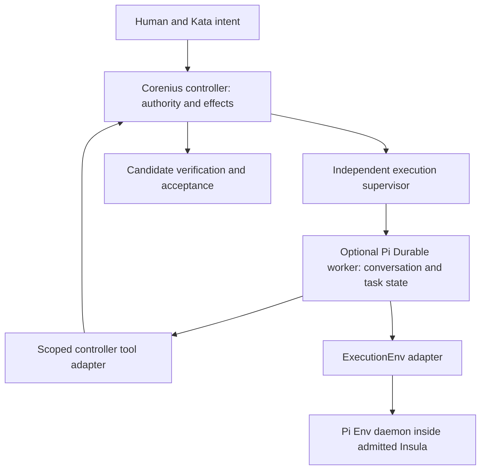

# Pi Durable and Pi Env: reuse in Corenius

Research date: 2026-10-06. Corenius source read:
`d7f674829e9844d011869b711d64fcf55313f7f1`. Pi source read:
`ae92585d3b3e5f1e4b123d14a34314d826d8d9f5` on `main`.
Both package manifests say `1.0.4`, but this snapshot includes **unreleased
changes**, including breaking Durable API changes. Do not treat the reviewed
checkout as identical to the published npm artifacts. See the
[Durable changelog][changelog] and [Env changelog][env-changelog].

This is a research recommendation, not an approved architecture or an implemented
integration. **Source** means implementation inspected; **Tested** means exercised
in this spike; **Inference/proposal** means our interpretation or suggested work.
Historical local qualification is explicitly identified and was not rerun here.

## Recommendation

**Reuse the contracts and tests first. Evaluate Pi Durable as an optional worker
runtime, and Pi Env as a subordinate tool transport. Keep Corenius's execution
authority, effect journal, independently supervised processes, and Insula boundary.**

Pi supplies substantial implemented machinery for the *inside* of a reasoning
runtime: checkpointed tasks, conversation state, tool recovery policy, background
subagent patterns, and committed UI projections. Env adds a relatively small Rust
filesystem/command daemon with a TypeScript client. Neither package replaces an
authority-bearing engineering controller or proves that an external effect has
stopped. [Durable overview][durable-readme], [Env protocol][protocol],
[Corenius runtime](../../../controller/src/runtime.rs).

The most useful distinction is three separate lifetimes:

1. **Reasoning state:** Pi Durable can resume persisted work from checkpoints.
2. **A remote tool connection:** Pi Env attempts to stop active commands when the
   transport closes; reconnect starts a new daemon, not an adopted execution.
3. **An admitted engineering execution:** Corenius retains identity, authority,
   capacity and uncertain effects independently of a reasoning process.

These lifetimes can be composed, but cannot be substituted for one another.
The package reviews below contain the detailed source and test evidence.

## Reading map

- [Pi Durable source review](pi-durable-source-review.md): records, APIs, task
  scheduler, tools, submissions, persistence, views, reload and recovery.
- [Pi Env source review](pi-env-source-review.md): client, wire protocol, Rust
  daemon, SSH deployment, filesystem behavior, process cleanup and probes.
- [Research intent](../../efforts/pi-env-durable/EFFORT.md) and
  [ticket](../../efforts/pi-env-durable/tickets/01-pi-research.md).

## What each package actually provides

### Pi Durable

**Source.** A TypeScript library built on `pi-ai` for model requests and Chord
for typed document state and observation. `Harness` owns one `Session` and task
scheduler. Conversation entries, document mutations, submission changes and task
checkpoints share an atomic commit boundary. Generation and tool execution are
themselves built-in tasks. This is explicit checkpointed state-machine execution,
not arbitrary program replay or a distributed workflow service.
[README][durable-readme], [specification][spec].

The core public surface includes `Harness.open`, `root`, `createConversation`,
`submit`, `wait`, `resume`, conversation `commit`, `configure`, `fork`, `reset`,
`compact`, `abort`, `viewState`, `watch`, and task/document definitions. Tools,
hooks and prompt sections come from a reloadable registry; persisted state stores
names and versions, not the JavaScript implementation. A restart must supply the
appropriate definitions again. [README][durable-readme].

One model/tool round is approximately:

```text
durably admit input
  -> generation task prepares and calls model
  -> commit assistant/tool-call entries
  -> tool tasks commit execution intent, then perform effects
  -> commit tool results
  -> next generation or final answer
```

Recovery has a deliberate ambiguity policy: a tool interrupted after intent is
rerun only when both its recorded replay policy and its current implementation
say `safe`. Otherwise it produces an interrupted result saying it may have
partially run. A checkpoint is not an exactly-once external-effect guarantee.
The safe recovery path directly calls the current implementation; a pre-execution
hook is not a sufficient place for a revocable authority check.
[Tool implementation][tool].

An interrupted result can also lead the model to request the action again as a
new tool call. Conservative automatic replay policy therefore does not replace
Corenius's retained uncertainty and reconciliation of the original effect.
[Recovery tests][tool-recovery].

**Source.** Storage options are memory, Node SQLite, JSONL, and a Cloudflare
Durable Object SQLite adapter. Library storage assumes a single owner and
provides no cross-process lifetime lock. Node SQLite selects WAL with
`synchronous=NORMAL`; this must not replace Corenius's explicitly checked
`FULL` setting for controller state. JSONL's `fsync` option also needs its exact
marker/sidecar ordering understood; the detailed review distinguishes the source
behavior from a claim of host-power-loss durability. [Storage overview][durable-readme],
[Corenius storage open](../../../controller/src/lib.rs).

The existing experimental Pi coding agent demonstrates the library end to end:
SQLite sessions, committed conversation views, subagent navigation and a task
graph. It adds an application session lock and reuses Pi auth/settings/TUI.
It is a separate experimental entry point, not evidence that all normal Pi CLI
features are available through Durable. Its README explicitly lists missing
features. [Experimental agent][experimental].

### Pi Env

**Source.** `RemoteExecutionEnv` implements the Durable `ExecutionEnv` contract,
which combines `FileSystem` and `Shell`. It delegates through `Connection` to a
Rust `pi-env serve` daemon over framed stdin/stdout, often transported by SSH.
The TypeScript host keeps model access and Durable storage local; the daemon
performs file and command operations under its operating-system identity.
[README][env-readme], [environment contract][env-contract].

The protocol includes shell strings and direct argv execution, distinct stdout
and stderr output, file reads/writes, positional binary reads, paged directories,
line scanning, watches, cancellation and keepalive. Frames carry a request ID,
JSON header and optional binary payload, with a 16 MiB frame limit. It offers bounded reader and output-window modes; output windows can avoid
transferring bytes the client would discard. These do not impose a global memory
or concurrency limit. Control responses take priority over bulk output. These are directly
useful ideas for Corenius's operator views and log transport. [Protocol][protocol].

SSH helpers detect the target platform and deploy a content-addressed binary,
verify its SHA-256 before launch, and require an application-owned known-hosts
file with strict checking. Documented targets are Linux, macOS, Android/Termux
and Windows on x86-64/arm64; this spike's execution evidence is Linux only.
Host-key acceptance still requires a trusted fingerprint comparison; a scan is
not proof of host identity. [Env README][env-readme], [SSH implementation][ssh].

**Source and tested caveats.** Reconnection loses in-flight outcomes and daemon
handles. Completed request IDs can be reused to execute the same mutation again.
Normal connection EOF kills an active command in the tested case, but daemon
SIGKILL, a descendant using `setsid`, and a completed shell with a surviving background child
do not supply whole-execution termination. See the precise observations and
reproduction in the [Env review](pi-env-source-review.md).

**Inference.** Env is useful for interactive, bounded tool operations inside an
already admitted environment. It is a poor replacement for an execution service
whose jobs must outlive transports and whose cancellation must prove that all
descendants have stopped.

## Where Corenius stands at the pinned commit

There are two relevant layers; treating Corenius as just its initial terminal
prototype materially understates the existing implementation.

| Layer | Source observation | Implication for reuse |
| --- | --- | --- |
| Terminal prototype | `Coordinator`, `ProviderSession`, `ToolRegistryLike`, policy/approval handling and append-only transcript in `terminal_agent/src/core`; Insula shell runner in `terminal_agent/src/insula.rs` | Durable offers richer recovery and conversation machinery, but inserting it changes who owns the agent loop. |
| Current local controller | Rust `controller`, private SQLite/socket, principal/epoch authority, expected revisions, argument-checked idempotency receipts, operation journal | Retain this as authority. A Pi conversation database has a different job. |
| Independent execution supervisor | Operation-bound execution identity, lookup before ambiguous dispatch, cancellation tombstones, namespace and pidfd validation, capacity held on unknown effects | A connection-scoped Env daemon cannot replace this lifecycle. |
| Git/Kata integration | Admitted source identity, isolated private repositories, retained immutable candidates, independent verification, acceptance and conditional fast-forward effects | Pi tools may request scoped actions; they must not turn transcript completion into acceptance or landing. |
| Operator views/native bindings | Authenticated projections, retained public inputs, native identity checks and explicit coverage gaps | Pi's views and output bounds offer design ideas, but their transient observation stream is not evidence coverage. |

Source map: [runner](../../../terminal_agent/src/core/runner.rs),
[transcript](../../../terminal_agent/src/core/transcript.rs),
[controller](../../../controller/src/lib.rs),
[runtime reconciler](../../../controller/src/runtime.rs),
[supervisor](../../../controller/src/supervisor.rs),
[Git effects](../../../controller/src/git.rs),
[Git workspace backend](../../../controller/src/git_workspace.rs),
[monitor](../../../controller/src/monitor.rs).

**Qualification limit.** The current [implementation status](../../efforts/sqlite-controller/IMPLEMENTATION-STATUS.md)
says the complete live two-worker baseline remains unqualified. The richer
PostgreSQL/Temporal roadmap is parked historical material. The interfaces above
are observed implementation, not a new claim of complete production readiness.
Likewise the original `terminal_agent/src/insula.rs` boundary and the controller supervisor's
stricter namespace boundary are different implementations; don't infer the
supervisor's properties from the terminal prototype's shell plan.

## Concept mapping: preserve these distinctions

| Pi concept | Closest Corenius use | Why it is not an identity-equivalent replacement |
| --- | --- | --- |
| Conversation | A reasoning transcript attached to an Attempt or role | An `ExecutionScope` retains authority and jobs beyond its reasoning process. |
| Task/checkpoint | Internal worker orchestration state | A controller task is admitted work with source and acceptance semantics, not just a pending callback. |
| Background task ownership | Worker-local subagent cancellation/wait tree | Surviving a parent abort does not create an independently supervised service or grant a worker slot. |
| Commit | Atomic reasoning-state mutation | It is not a controller admission, acceptance receipt or external effect confirmation. |
| Submission `requestId` | Duplicate-input suppression | Same-type duplicates return the old submission without checking changed content; Corenius receipts bind arguments and authority epoch. |
| `ExecutionEnv.id` | Filesystem namespace key for file serialization | It is not a grant, process identity, Insula contract digest, or `WorkspaceGeneration`. |
| `cwd` | Working-directory selection | It is not a filesystem access boundary. |
| Provider session UUID | Model cache/session affinity | It is not Corenius's validated runtime/store/incarnation binding. |
| Watch/view update | Operator presentation | Coalescing/reconnect snapshots are not an append-only audit cursor or proof of complete review. |
| Tool `interrupted` / task terminal | A reasoning-level result | It does not prove an external command stopped or release Corenius capacity. |

Source: [Corenius domain language](../../../CONTEXT.md), [Pi concepts][durable-readme],
[submission implementation][submissions], [environment contract][env-contract],
[Corenius receipts](../../../controller/src/lib.rs).

## Reuse options, ranked

### 1. Adopt specific contracts and adversarial tests

**Proposal; highest immediate value, no new production runtime required.**

- Port the distinction between replay-safe and ambiguous tool effects into any
  future recovery of the terminal prototype. Store the intent before invocation;
  make reconciliation explicit for non-idempotent effects. Preserve Corenius's
  stronger operation IDs and authority rechecks.
- Apply Env's bounded binary reader, directory paging, output tail/skip metadata,
  separate stdout/stderr, and watcher overflow semantics to remote workspace and
  operator reads. A dropped output region must remain a coverage gap, not become
  verified evidence.
- Reuse the style and cases of Env's local-vs-remote differential tests and its
  reusable environment conformance suite when adding any new Corenius environment
  adapter. This is more valuable than merely copying its function names.
- Borrow Durable's explicit ownership tree, bottom-up abort, `waiting` and
  `completing` states for presentation or worker-local orchestration where they
  reduce ambiguity. Do not add a second global work allocator.

Concrete seams: terminal [tool registry](../../../terminal_agent/src/tools.rs) and
[runner](../../../terminal_agent/src/core/runner.rs); controller
[bounded query/view](../../../controller/src/query.rs) and
[monitor](../../../controller/src/monitor.rs); future environment
adapter. Sources: [tool recovery][tool], [environment contract][env-contract],
[Env tests][env-tests], [task specification][spec].

### 2. Evaluate Pi Env inside an existing Insula

**Proposal; narrow transport experiment.** Use the Rust daemon unchanged where
its semantics suffice, driven by the official TS client in a small experimental
host. `ConnectionOptions.command` accepts an argv command/factory, so the launch
can be a trusted wrapper entering a preselected Insula rather than `connectSsh`
launching on the unrestricted host. [Connection API][connection].

Requirements before a product adapter:

1. Place the **whole daemon** inside the approved boundary. Wrapping only `exec`
   leaves filesystem RPCs outside it. Absolute paths and `cwd` are not confinement.
2. Select the environment from controller-owned Attempt/workspace bindings, never
   model-supplied SSH destinations or paths. Choose stable filesystem namespace
   IDs that cannot collide across environments or obscure a replaced workspace.
3. For remote hosts, deployment and admission remain trusted operator/Armada and
   Insula concerns. SSH convenience does not establish an Insula contract.
4. Keep long-lived jobs on the existing execution service. If a tool launches
   one, return its controller operation/execution identity and poll through a
   separately authenticated adapter.
5. Map transport loss to uncertainty. Never resend arbitrary writes/commands as
   though the wire request ID were a durable idempotency key; never release a
   worker slot because a tool promise rejected.
6. Ensure model credentials, controller storage and other Attempts are absent
   from the daemon's projections. Custom JavaScript tools can bypass `env`, so
   host isolation and extension trust remain separate requirements.

A native Rust client is possible, but creates maintenance responsibility for a
package-specific evolving protocol and Node-compatible filesystem semantics. First prove
the value with the official client. If Rust integration wins, pin the daemon and
run the same conformance/failure cases against the Rust implementation.

### 3. Evaluate Pi Durable as an optional reasoning worker

**Proposal; larger, potentially valuable experiment.** Let one bounded TypeScript
worker own a Pi SQLite session and its single-writer lock. Bind that session to
one controller-issued Attempt. The controller still admits, observes, cancels,
verifies and accepts work; Pi manages the worker's conversation and internal task
tree. This can explore a more composable harness without first replacing the
controller or the existing Codex/Trae paths.



This is a proposed topology. Model credential placement and the worker's own
host permissions require an explicit design; the diagram does not grant a Pi
worker access to controller/operator secrets.

Concrete work needed:

- Add a distinct worker runtime adapter. The current native binding path is
  Codex-specific; Pi Durable is not an ACP provider and is not a drop-in
  `ProviderSession` implementation. It owns the generation/tool loop itself.
- Bind Attempt, admitted intent/base, workspace and runtime/store identities in
  trusted adapter state. Do not derive authority from conversation text, a Pi
  provider session ID or a document writable by arbitrary extensions.
- Persist the original controller request and stable idempotency key before a
  scoped effect. Reconcile/replay that exact request after ambiguous responses;
  recheck current grant at the service boundary. A tool marked `safe` is only
  safe when this wrapper makes repetition safe.
- Preserve different identities for a Pi task, model tool call, submission,
  Corenius operation and external execution. A retry should not mint a fresh
  operation identity merely because the Pi process restarted.
- Render Pi view state as worker progress, keeping acceptance and review coverage
  in controller-owned evidence. If a UI reconnect coalesces frames, display the
  snapshot without claiming the missing history was reviewed.
- Keep registry/model configuration pinned for recovery. Pi resolves names to
  currently installed code, and pending tool calls can see updated configuration.
  Record code/dependency identity rather than assuming checkpoint version alone
  defines the implementation that will run.
- Decide who owns model transport and credentials. `pi-ai` direct model access
  does not automatically preserve the qualified Codex native session, relay or
  operator UI path. A faux model is sufficient for the first experiment.

Useful primary examples: [foreground subagent][foreground],
[background subagents][background], [child tasks][children],
[per-conversation environment][sandbox-example], and [reload/restart][reload].
The environment example uses directories, explicitly not an implemented sandbox.

### 4. Do not migrate the authority ledger into Pi storage

**Recommendation.** There is no demonstrated benefit that justifies discarding
the current command authentication, grant revocation, argument-bound receipts,
effect reconciliation, candidate proof and protected-ref semantics. Pi storage
does not supply those contracts. Do not point Pi's SQLite adapter at the
controller database or treat a Chord document as an admitted grant.

Similarly, background Pi tasks should not replace independently supervised
executions, and a successful Pi answer should not close an acceptance contract.
The package is a useful worker-runtime candidate, not a ready-made team control
plane. This follows the source comparison above; it is not a claim that such a
control plane could never be built on top of Pi.

## Bounded follow-up probes

The owner authorized the interrupted-effect probe on 2026-10-06. Its bounded
ledger-mutation test passed; see [results and limits](interrupted-effect-probe.md).
The other rows remain proposed acceptance tests. Run without paid models first;
stop at evidence before choosing an architecture.

| Probe | Smallest setup | Pass criteria / decision unlocked |
| --- | --- | --- |
| Environment boundary | Official client + pinned daemon entirely inside a disposable Insula | File RPCs, symlinks and commands cannot reach a sentinel outside projections; no host secrets; binary reads, argv, output bounds and cancellation agree with the selected contract. Decides whether to reuse Env transport. |
| Interrupted external effect | Faux Pi model + one controller-backed test tool; lose reply after committing effect | Same saved operation is looked up/replayed once, changed arguments refused, revoked grant refused, no duplicate effect; unknown stays unknown. Decides whether Pi can be a subordinate worker. |
| Reasoning-process restart | Kill worker after checkpoint while controller-owned job runs | Reopened Pi session resumes reasoning without a second execution, changed workspace/runtime identity is refused, controller capacity remains occupied until its own terminal proof. |
| Output and reconnect | Fast noisy command, slow observer, link loss and reconnect | Memory/transfer remain bounded; skip counters and watcher overflow appear; old handles fail; historical evidence gaps stay visible. Decides whether the output design is worth porting. |
| Ownership and authority | Parent abort with foreground/background Pi tasks and a revoked Corenius Attempt | Pi ownership behaves as specified, but no task bypasses revocation or releases controller capacity through a local terminal state. |
| Upgrade and storage owner | Two processes target one session; reopen under changed registry/version | Host lock prevents dual ownership; missing/incompatible definitions block explicitly; code and identity changes cannot silently execute pending effects. |

Do not use a full paid two-worker run as the first discriminator. These probes
separate transport compatibility, reasoning recovery and effect authority so a
failure has a clear meaning. A successful probe would justify a design decision
and implementation spec, not automatic migration.

## Maturity, cost and licensing

**Source.** Durable labels its API experimental and subject to change without
notice. Env's initial changelog release is 1.0.4 on 2026-10-05, one day before
this read. Durable has adjacent breaking environment/storage changes. Both
manifests require Node >=22.19.0 and use the MIT license; the daemon is a Rust
binary, not a published stable Rust library API. Its Cargo package version is
distinct from the npm/wire package version. [Durable README][durable-readme],
[changelogs][changelog], [Env changelog][env-changelog], [daemon manifest][cargo],
[license][license].

**Inference.** Avoid floating upgrades for any trial that retains pending work.
Pin the upstream commit or coherent released artifact set, retain MIT notices
when copying code, record dependency and daemon digests, and include migration
and failure tests in the decision. TS integration adds Node/Chord/pi-ai lifecycle
and packaging work; a Rust port avoids the host runtime but takes on semantic
compatibility and maintenance. No performance superiority or production
reliability claim was established by this spike.

## Verification and limits

Package-level commands, probe source and observed results are recorded in the
two source reviews. The Env investigation exercises local Linux daemon/client
behavior; Durable uses focused model-free tests. This is not an external SSH,
Windows/macOS, credentialed-provider, host-power-loss, deployment or complete
Corenius integration qualification. No product source or dependency was changed.
Final document/tracker checks are recorded in the research ticket and state.

[durable-readme]: https://github.com/earendil-works/pi/blob/ae92585d3b3e5f1e4b123d14a34314d826d8d9f5/packages/durable/README.md
[spec]: https://github.com/earendil-works/pi/blob/ae92585d3b3e5f1e4b123d14a34314d826d8d9f5/packages/durable/docs/spec.md
[tool]: https://github.com/earendil-works/pi/blob/ae92585d3b3e5f1e4b123d14a34314d826d8d9f5/packages/durable/src/harness/tool.ts#L38-L127
[tool-recovery]: https://github.com/earendil-works/pi/blob/ae92585d3b3e5f1e4b123d14a34314d826d8d9f5/packages/durable/test/harness-tools-recovery.test.ts
[submissions]: https://github.com/earendil-works/pi/blob/ae92585d3b3e5f1e4b123d14a34314d826d8d9f5/packages/durable/src/harness/submissions.ts#L148-L163
[env-contract]: https://github.com/earendil-works/pi/blob/ae92585d3b3e5f1e4b123d14a34314d826d8d9f5/packages/durable/src/env/index.ts
[env-readme]: https://github.com/earendil-works/pi/blob/ae92585d3b3e5f1e4b123d14a34314d826d8d9f5/packages/env/README.md
[protocol]: https://github.com/earendil-works/pi/blob/ae92585d3b3e5f1e4b123d14a34314d826d8d9f5/packages/env/docs/protocol.md
[connection]: https://github.com/earendil-works/pi/blob/ae92585d3b3e5f1e4b123d14a34314d826d8d9f5/packages/env/src/connection.ts#L53-L62
[ssh]: https://github.com/earendil-works/pi/blob/ae92585d3b3e5f1e4b123d14a34314d826d8d9f5/packages/env/src/ssh.ts
[env-tests]: https://github.com/earendil-works/pi/tree/ae92585d3b3e5f1e4b123d14a34314d826d8d9f5/packages/env/test
[experimental]: https://github.com/earendil-works/pi/blob/ae92585d3b3e5f1e4b123d14a34314d826d8d9f5/packages/coding-agent/src/experimental/durable/README.md
[foreground]: https://github.com/earendil-works/pi/blob/ae92585d3b3e5f1e4b123d14a34314d826d8d9f5/packages/durable/test/examples/22-subagent-foreground.ts
[background]: https://github.com/earendil-works/pi/blob/ae92585d3b3e5f1e4b123d14a34314d826d8d9f5/packages/durable/test/examples/23-subagent-background.ts
[children]: https://github.com/earendil-works/pi/blob/ae92585d3b3e5f1e4b123d14a34314d826d8d9f5/packages/durable/test/examples/24-child-tasks.ts
[sandbox-example]: https://github.com/earendil-works/pi/blob/ae92585d3b3e5f1e4b123d14a34314d826d8d9f5/packages/durable/test/examples/29-sandbox-per-conversation.ts
[reload]: https://github.com/earendil-works/pi/blob/ae92585d3b3e5f1e4b123d14a34314d826d8d9f5/packages/durable/test/examples/31-reload-and-restart.ts
[changelog]: https://github.com/earendil-works/pi/blob/ae92585d3b3e5f1e4b123d14a34314d826d8d9f5/packages/durable/CHANGELOG.md
[env-changelog]: https://github.com/earendil-works/pi/blob/ae92585d3b3e5f1e4b123d14a34314d826d8d9f5/packages/env/CHANGELOG.md
[cargo]: https://github.com/earendil-works/pi/blob/ae92585d3b3e5f1e4b123d14a34314d826d8d9f5/packages/env/daemon/Cargo.toml
[license]: https://github.com/earendil-works/pi/blob/ae92585d3b3e5f1e4b123d14a34314d826d8d9f5/LICENSE
