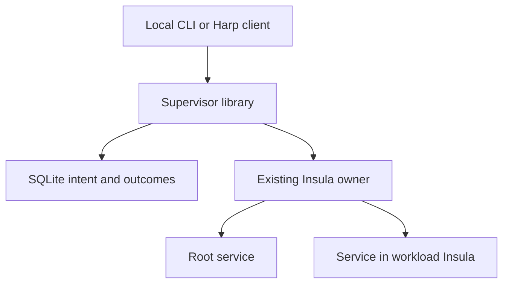

# Insula service supervisor

A reusable Rust library and a thin local daemon/CLI for declared services. Tokio
drives asynchronous operations; rustix supplies Unix ownership locks, socket
operations and Linux process-handle primitives. SQLite stores durable intent,
operation outcomes, generations and structured events.

**Integration status:** the library, Unix owner client, daemon, CLI and acceptance
fixtures are implemented. The existing Insula owner source was not present in
the workspace or found in the accessible repositories. Therefore this package
does not claim a completed integration with that owner. Implement
`ExecutionOwner` in the existing owner, or expose its methods through the
documented Unix protocol. The production binary contains no alternative service
launcher, keeper, namespace implementation or child-reaping loop.

The test-only owner uses real Linux processes and pidfds to exercise the full
supervisor and CLI. It supports an explicitly declared `direct_process` boundary.
It cannot certify that arbitrary descendants or Insula namespaces are empty.
Production declarations default to the stronger `service` boundary and are
rejected unless the real owner advertises that capability.

## Build and verification

Requirements: Linux with pidfds and Unix sockets, a C toolchain for bundled
SQLite, Rust 1.89 or later, and tmux for the acceptance suite. The recorded full
verification uses Rust 1.99.1 and tmux 3.4. `Cargo.lock` is included.

```sh
cargo build --locked
cargo test --locked --all-targets
cargo clippy --locked --all-targets -- -D warnings
cargo fmt --check
```

The tmux tests fail with a clear prerequisite message if tmux is absent. For a
private installation, set `INSULA_TEST_TMUX` to the binary and, when required,
`INSULA_TEST_TMUX_LIB` to its library directory. Tests create private temporary
directories and sockets; they do not use your ordinary tmux server. See
[verification evidence](docs/VERIFICATION.md) for the actual result and scope.

## Ownership and execution boundary



The supervisor chooses service lifecycle actions. The owner admits and performs
them through its one authoritative launch/stop path. Harp continues to choose
workflow dependencies, expensive retries, checkpoints and result acceptance.
Terminal reconnection, terminal-server replacement and workflow recovery remain
separate actions. The supervisor has no built-in Codex turn resubmission,
checkpoint restoration or workflow retry mechanism, and it never interprets a
pane exit as a workflow result. Foreground declarations can name arbitrary
executables: operators must keep training launches, benchmarks and other
expensive effects out of automatically replayed service bootstrap. `replay_safe`
is an explicit operator assertion, not a classifier of command side effects.

`src/owner.rs` defines eight methods: `capabilities`, `claim`, `validate`,
`observe`, `launch`, `stop`, `probe`, and `release`. Each effect is fenced by the
owner's exclusive controller epoch; destructive effects also carry the exact
generation. The owner must bind target Insulas to the admitted root, reserve
physical service endpoints in the target namespace, and validate at the actual
effect after all queueing and awaits. See [the owner protocol](docs/OWNER_PROTOCOL.md)
for complete semantics and wire types.

Two independent protections prevent concurrent controllers:

1. A kernel `flock` lives in the owner-reported canonical authority directory,
   independently of the supervisor's state or socket directory. The file is
   never unlinked. Its descriptor is close-on-exec, and inode/permissions are
   rechecked before mutations.
2. The authoritative owner grants one live claim connection and monotonic epoch
   per root. Claim loss fences old work before takeover. Every owner effect
   checks the claim and generation under the owner's admission gate.

A local lock alone cannot fence delayed requests inside another process. A
renewable time lease without effect fencing is also insufficient. This version
does not implement distributed ownership or time-based leader election.

## State and idempotency

Each service is identified by `(target Insula ID, stable service ID)`. Its state
tracks desired running/stopped, lifecycle, readiness and health independently.
Every replacement receives a fresh UUID generation. Stored identity includes
owner identity, boot ID, PID, process start time and generation. Once recorded,
that identity cannot change while retaining the same generation.

Start, stop and restart requests require a UUID operation ID. Stop and restart
also require an expected generation. An accepted operation ID binds its complete
request, including configuration and expected generation. Repeating that request
returns its recorded outcome; changing the payload under the same ID is a
conflict. Concurrent operations serialize per service. Tmux endpoint reservations
also prevent different service IDs in the same Insula from using one socket.

One user restart has a stop phase and a replacement-launch phase. Each phase
has its own durable owner operation ID; one ID is never reused for two different
owner requests. The new generation is admitted only after the owner certifies
that the previous required boundary is empty and no pending old launch can
materialize. Explicit restart and automatic recovery have distinct event types
and `origin` values.

An accepted mutation runs in a supervisor-owned task. Disconnecting the client,
canceling its wait or timing out does not abandon the admitted operation. A lost
response can mean `unknown`; retry with the **same** operation ID or query it.
Successful historical operation results retain their historical generation even
after the service has a replacement.

### Crash windows

Intent, phase, generation, owner operation IDs and controller epoch commit before
the owner is called. SQLite uses WAL and `synchronous=FULL`; state, operation
outcome and event commit together. On startup, the controller claims ownership
and reconciles all saved declarations before serving mutations.

| Owner evidence | Supervisor action |
| --- | --- |
| Verified live process with the recorded generation and identity | Resume observation; resolve a pending launch from live authoritative evidence |
| Verified empty boundary and no unresolved launch | Record the observed exit; allow a new policy-authorized or explicit operation |
| Missing proof, unknown ownership, inaccessible target or identity mismatch | Publish `unknown`, become unready and prevent duplicate launch/destructive action |
| Same-epoch pending stop with a live process | Keep the stop pending: liveness does not prove that its old cleanup request has finished |

A new exclusive controller epoch can adopt a verified survivor after the owner
has fenced all effects from the old epoch. An interrupted restart with no
verified replacement or completed outcome stays visibly unknown. It is not
silently replayed. If replacement launched but its reply was lost, authoritative
live evidence can resolve that pending launch as succeeded. A fresh explicit
request can proceed after the owner supplies complete empty-boundary evidence.
SQLite does not recreate a pidfd, reconstruct a lost exit result or establish
whether an arbitrary command had an external effect.

## Declarations and probes

Examples are in `examples/tmux.json` and `examples/foreground-http.json`. Adjust
their paths, target IDs, UID and GID to the identities admitted by your owner.
The HTTP example uses Python's simple file server solely to demonstrate an
ordinary foreground process; substitute your actual API/coordinator executable.

Declarations carry explicit executable/argument arrays, cwd, environment
references, runtime identity, revision, adapter, readiness and health probes,
startup grace, restart/backoff/budget, graceful stop/deadline/force permission,
log limits, cleanup boundary and controller-exit policy. The complete declaration
has a SHA-256 digest. A changed live configuration must be stopped before a new
configuration is started.

`env_refs` maps an environment variable name to an owner-resolved reference:

```json
{"HF_TOKEN": "credentials/huggingface"}
```

The value above is a reference, never the secret itself. Resolve it only in the
owner immediately before execution. Arguments are literal nonsecret strings;
do not put tokens/passwords into arguments or service IDs. The supervisor cannot
infer whether an arbitrary caller-supplied literal is secret. Resolved values
are never sent through the supervisor protocol. Status and lifecycle events
exclude command descriptions; probe result codes are reduced to a fixed
vocabulary, and raw command output/HTTP content never enters them. The owner
must enforce the service's logging policy and secret handling at its output sink.
The native test owner deliberately discards service output entirely.

Probe kinds are process, command, Unix socket, numeric-address HTTP and tmux.
Each has a deadline, interval, consecutive-failure threshold and output bound.
Eight supervisor probes can be outstanding at once; the owner also bounds the
complete lifetime of its probe workers, including cleanup. Late replies require
both the current generation and a current per-role probe sequence. They cannot
make a stopped service ready or mark a replacement unhealthy.

Probe mechanism failures and unavailable targets produce unknown health and do
not trigger automatic recovery. Health observations are distinct from restart
decisions. Startup grace suppresses early health-failure accumulation. Readiness
can be false while the process remains alive and healthy.

`LocalProbes` is an optional helper for code **inside the owner context**. It
opens/verifies pidfds, checks Unix peer identity, bounds command output, and
terminates/reaps its direct probe child on cancellation or timeout. It does not
enter a target namespace or establish descendant containment. The real owner
must contain commands that fork and retain its runtime until reaping completes.

### Tmux and recovery policy

The tmux adapter passes an empty foreground server command:

```sh
/usr/bin/tmux -D -f /dev/null -S /run/insula-services/tmux/server.sock
```

It loads no user configuration, hooks, sessions or workload commands. Probes and
clients use `-N` to prohibit implicit server creation. The private endpoint must
belong to the verified server; expected session/pane information affects
readiness, while dead panes remain separate observations from server health.
Create sessions and launch work through explicit user/workflow actions after
the server starts. Restarting it creates a fresh empty server.

Automatic restart defaults to `never`. To enable recovery, declare `replay_safe`
and a bounded policy, for example:

```json
{
  "kind": "bounded",
  "max_restarts": 3,
  "initial_backoff_ms": 1000,
  "max_backoff_ms": 30000,
  "on_unhealthy": true
}
```

The budget counts **lifetime automatic replacement attempts for that stored
configuration**, not a rolling time window. It persists across controller
restarts. Exhaustion produces `budget_exhausted`; explicit restarts do not
consume or reset the automatic counter. Admitting a genuinely new declaration
after stopping the old configuration starts a new configuration record. Backoff
is deterministic exponential backoff with a configured cap. There is no jitter
or distributed recovery coordinator in this local first version.

## Run against the existing owner

First implement the owner contract. In-process integration uses:

```rust,no_run
# async fn integrate(owner: std::sync::Arc<dyn insula_supervisor::ExecutionOwner>)
# -> insula_supervisor::Result<()> {
let supervisor = insula_supervisor::Supervisor::open(
    owner,
    "root-instance-id".into(),
    "/var/lib/insula/supervisor".into(),
).await?;
// Expose local control and call tick periodically. On controller exit, call
// shutdown before shutting down the owner.
# Ok(())
# }
```

For a separate controller process, point the CLI at the **existing owner** socket:

```sh
insula-supervisor serve \
  --root-id root \
  --owner-socket /run/insula-owner/owner.sock \
  --state-dir /var/lib/insula/supervisor

insula-supervisor new-id
# Retain this ID and use it unchanged for any retry of the same request.
insula-supervisor start \
  --socket /var/lib/insula/supervisor/control.sock \
  --spec examples/tmux.json \
  --operation-id <retained-uuid>

insula-supervisor inspect \
  --socket /var/lib/insula/supervisor/control.sock \
  --insula root --service tmux

insula-supervisor restart \
  --socket /var/lib/insula/supervisor/control.sock \
  --insula root --service tmux \
  --generation <generation-from-inspect> \
  --operation-id <new-retained-uuid>

insula-supervisor watch-events \
  --socket /var/lib/insula/supervisor/control.sock --after 0
```

`stop` has the same fenced arguments as `restart`. `list`, `operation` and
`capabilities` expose current declarations, historical operation outcomes and
host/owner capabilities. Request commands return JSON; `new-id` prints a UUID.
`watch-events` prints one JSON event per line, uses durable sequence cursors and
reports an explicit history gap on stderr if retention passed the requested
cursor. The last 4,096 structured events are retained. Operation records are not
automatically pruned, preserving idempotency for old requests.

## Shutdown and operational limits

SIGTERM/SIGINT stops acceptance, drains admitted mutations, applies each
`stop_services` policy, and releases the claim. Graceful action, force permission,
deadline and child reaping belong to the owner. `keep_services` is accepted only
when the owner advertises verified survival after controller exit. Root or
sub-Insula destruction is an owner operation and is absent from this service
control API. The library refuses `cleanup_boundary: insula` for a service action.

Control and state directories must be absolute, private, owned by the controller
UID and free of symlink aliases. The local control socket is mode 0600 and checks
peer UID. The owner must keep its authority, endpoints and controller resources
outside workload-writable mounts and workload resource limits. Same-UID checks
alone do not provide isolation if a workload can write those paths.

Remaining integration gates are concrete: wire the real owner, verify its actual
bwrap/PID-namespace lifetime, establish service/probe cleanup boundaries on the
target host or pod, and run the same contract tests through that implementation.
The observed generic bwrap helpers use `--die-with-parent`; they are not evidence
that your real Insula keeper can preserve services after a controller crash.
This package deliberately leaves that capability unclaimed by the production
adapter until the real owner reports it.

Design references: [Tokio process](https://docs.rs/tokio/latest/tokio/process/struct.Command.html),
[Linux flock](https://man7.org/linux/man-pages/man2/flock.2.html),
[pidfd signaling](https://man7.org/linux/man-pages/man2/pidfd_send_signal.2.html),
[cgroup v2](https://www.kernel.org/doc/html/latest/admin-guide/cgroup-v2.html),
[tmux manual](https://github.com/tmux/tmux/blob/master/tmux.1).
